# Hola, soy Moisés

Estudio **Innovación Digital e Inteligencia Artificial** en Bolivia. Me interesa cómo una idea pasa de una conversación a un producto que alguien puede usar. Por eso disfruto tanto de diseñar el primer prototipo como de probarlo en un celular y descubrir qué le falta.

## Lo que exploro

| Área | En qué pongo el foco |
| --- | --- |
| **Producto y UX/UI** | Entender el problema, ordenar prioridades y diseñar interfaces fáciles de recorrer. |
| **IA aplicada** | Experimentar con asistentes, flujos multiagente e interacciones por voz. |
| **Desarrollo y prototipos** | Construir para web y móvil, probar en dispositivos reales y aprender con proyectos en C# y Unity. |

## Del problema al prototipo

**Entender → diseñar → construir → probar.** Si una prueba cambia lo que creía saber del problema, vuelvo al diseño con esa información.

### Proyecto para explorar

[**Juego del Calamar**](https://github.com/P-Moises/Juego-del-Calamar) · Experimento en C# para practicar lógica y mecánicas de juego.

<strong>Una curiosidad fuera del guion</strong>

A veces les mando notas de voz a mis propios programas. Cuando me entienden a la primera, lo cuento como una pequeña victoria.

---

[Explorar mis repositorios](https://github.com/P-Moises?tab=repositories)
